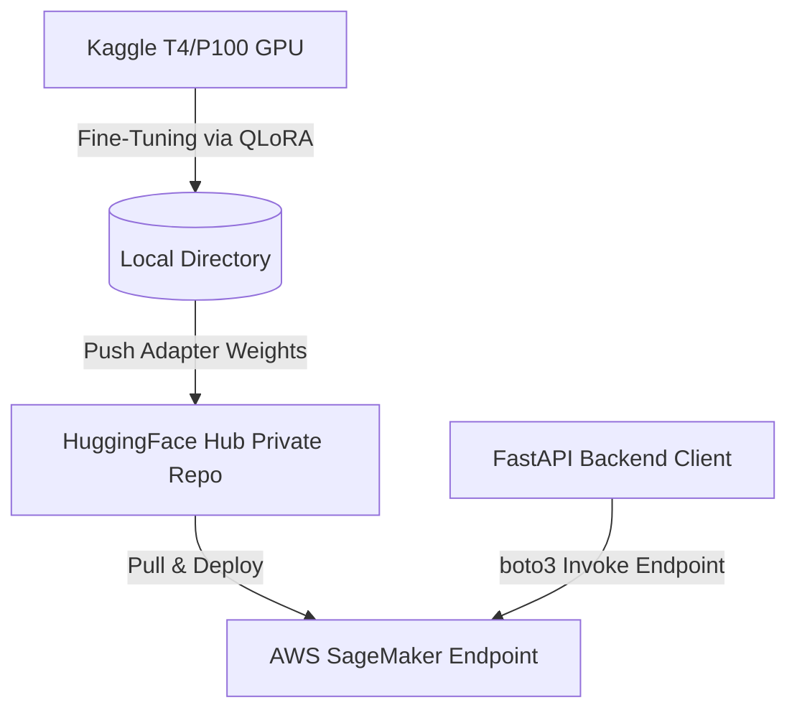

# MedGraph AI — Fine-Tuning & SageMaker Deployment Lifecycle

This directory contains the pipeline to fine-tune **Gemma 2 9B** on the standard **MedQA** clinical QA dataset on a Kaggle GPU (T4/P100), push the weights to a private **HuggingFace Hub** repository, and deploy it as a serverless or real-time inference endpoint on **AWS SageMaker**.

---

## Architecture Overview



---

## Phase 1: Training on Kaggle GPU

1. Open a new notebook on Kaggle and select **GPU T4 x2** or **GPU P100** accelerator.
2. Upload the contents of [fine_tune_medqa.py](file:///c:/PROJECTS/MedGraph/medgraph/fine_tuning/fine_tune_medqa.py) or install the required libraries in the notebook:
   ```bash
   pip install torch transformers datasets peft trl bitsandbytes huggingface_hub
   ```
3. Authenticate with HuggingFace (to download Llama/Gemma models and save weights):
   ```python
   from huggingface_hub import login
   login(token="YOUR_HUGGINGFACE_WRITE_TOKEN")
   ```
4. Run the training script. The script performs:
   * 4-bit NormalFloat (NF4) double quantization of the model parameters.
   * Compiles the Gemma 2 Instruct prompt templates around MedQA multiple-choice questions.
   * Fine-tunes target projection gates via QLoRA PEFT (`r=16`, `alpha=32`).
   * Saves the adapter weights in `./gemma-2-9b-medqa-lora/`.

5. Push the completed model adapters to the Hugging Face Hub:
   ```python
   from huggingface_hub import HfApi
   api = HfApi()
   
   # Create a private repository on your HF account
   repo_id = "your_username/gemma-2-9b-medqa-lora"
   api.create_repo(repo_id=repo_id, private=True, exist_ok=True)
   
   # Upload folder
   api.upload_folder(
       folder_path="./gemma-2-9b-medqa-lora",
       repo_id=repo_id,
       repo_type="model"
   )
   ```

---

## Phase 2: Deploying to AWS SageMaker

To deploy the adapter model to Amazon SageMaker, we use the Hugging Face LLM DLC (Deep Learning Container), which features Text Generation Inference (TGI) for high-performance inference.

Use the provided [deploy_sagemaker.py](file:///c:/PROJECTS/MedGraph/medgraph/fine_tuning/deploy_sagemaker.py) script to deploy the model:

```bash
# Set your AWS credentials
aws configure

# Execute the deployment script
python fine_tuning/deploy_sagemaker.py
```

---

## Phase 3: Integrating SageMaker in FastAPI Client

Once SageMaker deployment is complete, add the following variables to your local `.env` file:
```env
AWS_ACCESS_KEY_ID=your_aws_access_key
AWS_SECRET_ACCESS_KEY=your_aws_secret_key
AWS_REGION=us-east-1
SAGEMAKER_ENDPOINT_NAME=gemma-2-9b-medqa-endpoint
```

The MedGraph reasoning agent will automatically detect `SAGEMAKER_ENDPOINT_NAME`, initialize the `boto3` client, and route reasoning queries directly to your fine-tuned SageMaker endpoint, falling back to Gemini only if the endpoint is offline.
